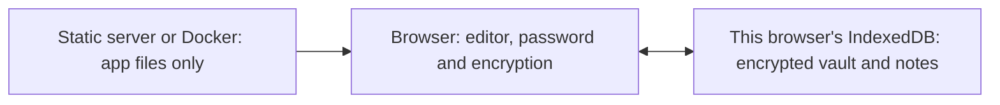

# Scrinium Community

[中文说明](README.zh-CN.md) · [Full Scrinium](https://scrinium-note.com/)

Local encrypted Markdown notes in your browser. A feature-frozen, source-available
community snapshot for noncommercial use, extracted from Scrinium.

## Where it runs

The editor, encryption, decryption, keys, search and note database run in your
browser. A local web server, a static host or the supplied Docker container only
serves HTML, JavaScript and CSS. It does not receive or store your notes.



The vault password is a local encryption credential, not a Scrinium account.
There is no username, email registration, online login or cloud sync. Each
browser profile and website origin has its own vault. A different port, domain,
browser or device is a different vault; use an encrypted backup to transfer it.
Clearing browser data can remove your vault. A Docker volume does not back it up.
The app must be served over HTTPS or localhost; opening index.html directly is
not a supported deployment.

## Run locally

This repository contains source code, not a desktop installer. Downloading the
ZIP alone does not start the app. Choose either the Node commands below or the
Docker command in the next section. The local preview running on the author's
machine has already completed these setup steps.

Use Node 20.19+ or 22.12+. From the repository directory:

```sh
npm ci --ignore-scripts
npm run build
npm start
```

Open `http://127.0.0.1:5194/`. No runtime environment variables, API keys, accounts
or backend database are required. `npm run dev` rebuilds and starts the same
static preview; it does not have a development HMR server. Rebuild after edits.
After the initial setup, run `npm start` from this directory to use the existing
build again. Keep the local server running while using the app. Developers can
run the automated checks separately with `npm test`.

## Docker

Install Docker with Docker Compose support, then run this from the extracted
repository directory:

```sh
docker compose up --build -d
```

Open `http://localhost:8088/`. The default port is bound only to this machine.
This command installs dependencies and builds the app inside Docker; Node does
not need to be installed on the host. After the first build, use
`docker compose up -d` to start it again, or `docker compose stop` to stop it.
The image uses a non-root static Nginx server and does not contain an application
API or note database. For remote hosting, provide HTTPS and preserve one stable
origin. The shipped production CSP blocks browser API connections and remote
images; it is a boundary, not a security-audit claim.

## Included

- Basic Milkdown Markdown editing, lists, tables, code highlighting, clipboard and undo/redo.
- Encrypted vault creation/unlock, recovery keys, password changes and key regeneration.
- Encrypted browser persistence, local search, notes, folders, outline and recoverable trash.
- Markdown/text/plain-JSON import, explicit plaintext-JSON export, encrypted community backup and recovery.
- Dark/light themes and left/center/wide reading layouts.
- Password-plus-typed-confirmation deletion of this community vault only.

Encrypted backups restore only into an empty community vault, after verifying
the password/recovery key and every encrypted note. They never silently replace
an existing vault. Other Scrinium editions' encrypted backups are not accepted;
export plain notes there and import those instead. Plain exports are unencrypted.

The community build excludes accounts, authentication servers, cloud sync,
subscriptions, payment, encrypted attachments, stored version history, graph
view, formula/diagram plugins, burner-note sharing, legacy/dead-man features and
the production app's Pro templates. It is not a drop-in replacement for every
hosted feature. Third-party editor libraries remain separately licensed.

## License and maintenance

Owned application code is under [PolyForm Noncommercial 1.0.0](LICENSE.md).
See [NOTICE](NOTICE.md), [third-party notices](THIRD_PARTY_NOTICES.md) and the
[official terms](https://polyformproject.org/licenses/noncommercial/1.0.0).
This is source-available software with a noncommercial restriction, not
OSI-approved open source. The full license, including its organization clauses,
controls permitted use; the restriction does not relicense the separate libraries.

Version 0.1.0 is a community snapshot, not a promise of feature parity or ongoing
support. There is no automatic synchronization with private Scrinium. Review
security or compatibility fixes separately before choosing to release a new tag.
[UPSTREAM.json](UPSTREAM.json) records the source commit and allowlisted files.

```sh
npm run upstream:check -- /absolute/path/to/private/scrinium
```

The command only reports upstream hashes; it never copies files or imports Pro
code. See [maintenance](docs/MAINTENANCE.md), [security boundaries](SECURITY.md)
and [validation](docs/VALIDATION.md). Do not use repository metadata or passing
unit tests as proof of an independent security audit.
