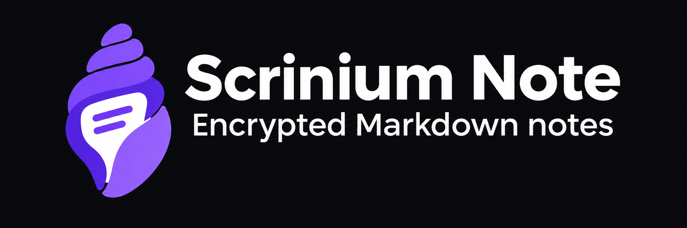

# Scrinium Note

[](https://scrinium-note.com/)

[English](README.md) · [在线托管版](https://scrinium-note.com/)

在浏览器里使用的本地加密 Markdown 笔记。这是一份功能固定的源码快照，
代码采用非商用许可。

## 在线托管版

需要跨设备加密同步、图片附件或版本历史，可以使用
[Scrinium Note 在线托管版](https://scrinium-note.com/)，直接在浏览器里使用，无需搭建本地服务。

## 下载源码

可以在仓库的 **Code** 菜单里下载 ZIP 并解压，也可以执行：

```sh
git clone https://github.com/th0t3p/scrinium-note.git
cd scrinium-note
```

## 软件运行在哪里

编辑、加密、解密、搜索和笔记数据库都在浏览器里运行。本机网页服务、静态托管
或 Docker 容器只负责提供网页文件，不接收或存储笔记。

打开后设置的密码用于解锁本地笔记库，不是云端账号密码。这个版本没有用户名、
邮箱注册、在线登录或云同步。

每个浏览器配置和网站地址都有各自的笔记库。换域名、端口、浏览器或设备后，
原来的笔记不会自动出现，需要通过加密备份迁移。清除浏览器数据可能会删掉笔记，
Docker 数据卷也不能备份这些浏览器数据。

## 本机启动

仓库提供的是源码，没有桌面安装包。下载 ZIP 后还要启动网页服务，不能直接双击
运行。下面的 Node 方式和 Docker 方式任选一种。

安装 Node 20.19 及以上版本，或 Node 22.12 及以上版本。在项目目录执行：

```sh
npm ci --ignore-scripts
npm run build
npm start
```

打开 `http://127.0.0.1:5194/`。不需要配置环境变量、API 密钥、账号或后端数据库。
修改代码后重新构建即可；本地预览没有热更新服务。
首次安装和构建后，下次在同一目录执行 `npm start` 即可。使用时保持网页服务运行。
开发者可以另行执行 `npm test` 运行自动化检查。

## Docker 启动

安装支持 Docker Compose 的 Docker 后，在解压出的项目目录执行：

```sh
docker compose up --build -d
```

然后打开 `http://localhost:8088/`。依赖安装和构建都在容器里完成，本机无需另装 Node。
首次构建后，下次执行 `docker compose up -d` 启动，执行 `docker compose stop` 停止。
容器里只有静态网页服务，默认只允许本机访问。放到远程服务器时需要配置 HTTPS；
生产版本会阻止网页中的 API 连接和远程图片加载。不能直接双击 index.html 使用。

## 保留的功能

- 基础 Markdown 编辑、列表、表格、代码高亮、剪贴板及撤销重做。
- 创建和解锁加密笔记库、恢复密钥、修改密码及重新生成恢复密钥。
- 浏览器内加密保存、本机搜索、笔记、文件夹、目录跳转及可恢复的回收站。
- 导入 Markdown、文本和明文 JSON，导出明文 JSON 或加密备份。
- 明暗主题及左对齐、居中、宽版阅读布局。
- 输入密码并明确确认后，删除当前浏览器中的这一个笔记库。

加密备份只恢复到空的 Scrinium Note 笔记库，验证密码或恢复密钥及每条笔记后才写入，
不会直接覆盖现有笔记库。其他 Scrinium 版本的加密备份不兼容；迁移时先在原版
导出明文笔记，再导入 Scrinium Note。明文导出文件不加密。

本仓库提供本地运行的版本。在线账号、加密同步和托管服务由
[Scrinium Note 在线托管版](https://scrinium-note.com/) 提供。

## 许可和后续更新

自有代码采用 [PolyForm Noncommercial 1.0.0](LICENSE.md)。非商用许可有用途限制，
因此这里使用“源码公开版本”的说法，不称为符合 OSI 定义的开源。
允许哪些用途，以完整条款为准；其中也有非营利组织等条款。第三方依赖仍按
各自原有的许可提供，不会被改成非商用许可。

0.1.0 是一份固定快照，不承诺与主项目保持功能一致，也不承诺持续维护。
没有自动同步任务。以后需要发布安全或兼容性修复时，再单独审阅、测试和发版。

[UPSTREAM.json](UPSTREAM.json) 保存来源提交和文件校验。
执行 `npm run upstream:check -- /absolute/path/to/private/scrinium` 只会报告变化，
不会复制文件或自动带入未公开代码。更多说明见 [维护方式](docs/MAINTENANCE.md)
和 [验证记录](docs/VALIDATION.md)。源码可读和测试通过不等于经过独立安全审计。
